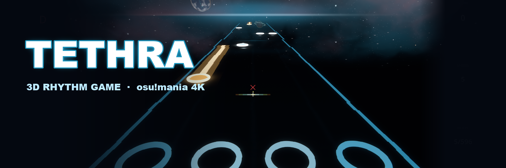
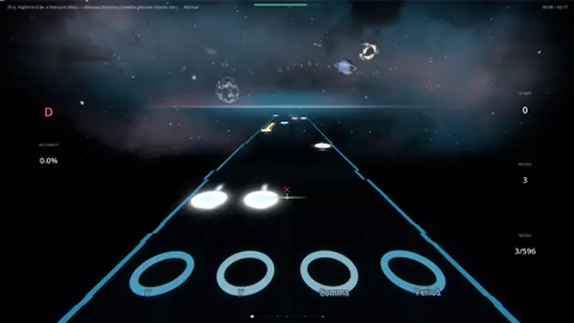
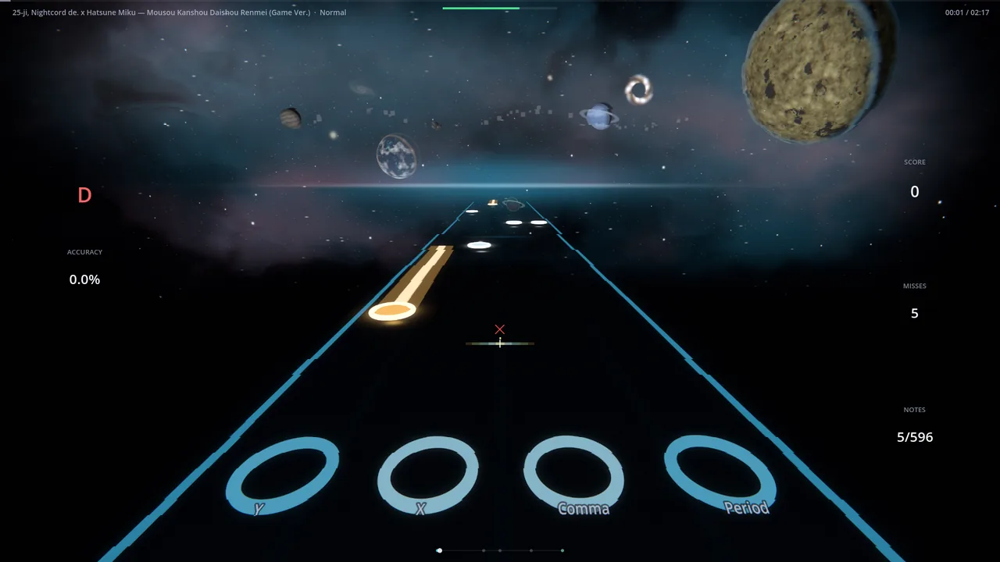
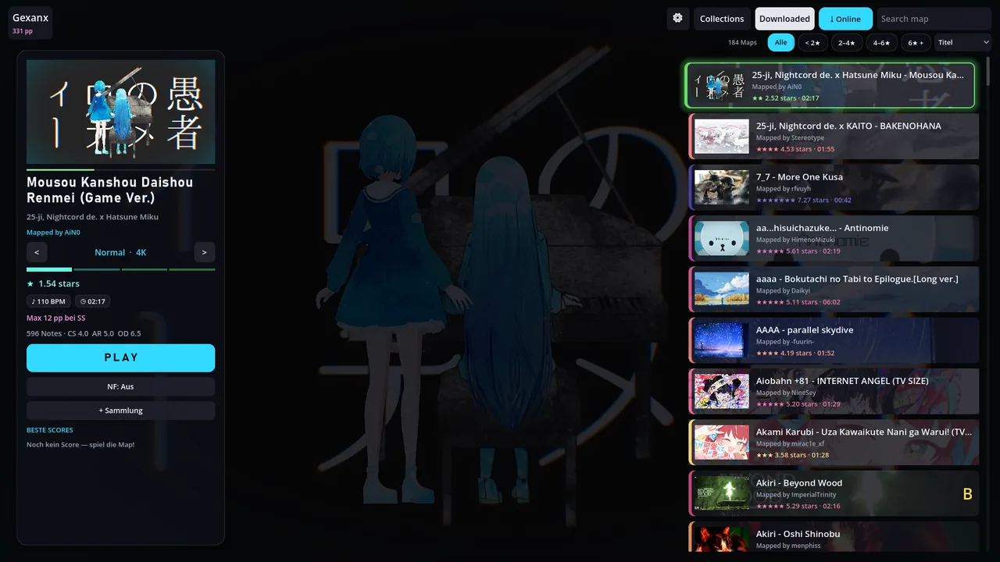
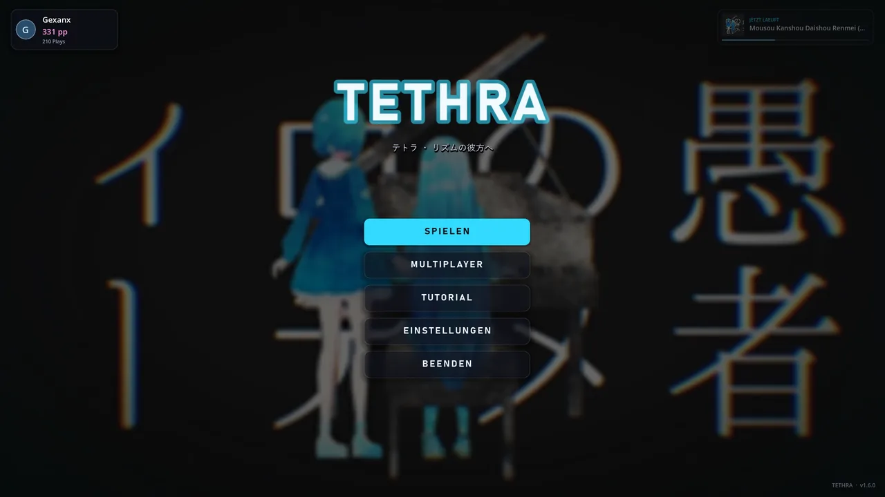
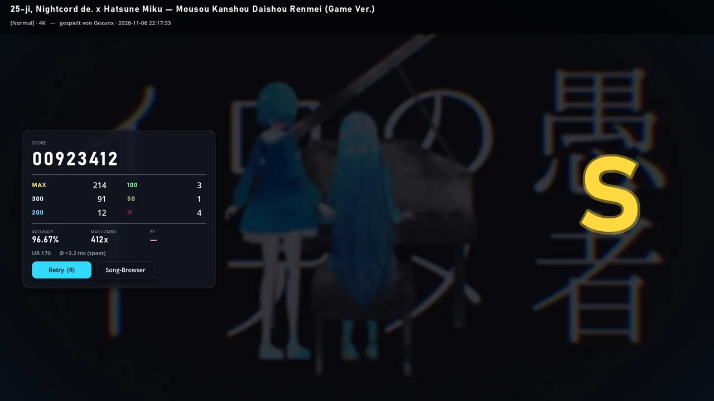

  

  <b>Fly through space to the beat. Play your osu!mania 4K maps in full 3D.</b>

  

  
  
  
  

  

## What is TETHRA?

TETHRA is a **3D space-flight rhythm game**. It reads standard **osu!mania 4K** beatmaps (`.osz`) and turns them into a lane you fly down, with exact osu! judgement and scoring.

## Features

- **Plays your maps.** Import any osu!mania 4K `.osz` beatmap.
- **Exact scoring.** osu! judgement windows and ScoreV1.
- **Scroll-speed maps.** SV maps behave exactly like in osu!lazer.
- **Star rating and pp** via rosu-pp.
- **Replays.** Watch your plays again.
- **Multiplayer.** Join friends with a room code.
- **Auto-updater.** New versions install themselves.

## Screenshots

<table>
  <tr>
    <td> Gameplay</td>
    <td> Song browser</td>
  </tr>
  <tr>
    <td> Main menu</td>
    <td> Settings</td>
  </tr>
  <tr>
    <td> Results</td>
    <td> Profile</td>
  </tr>
</table>

## Controls

| Action | Default key |
| --- | --- |
| Lanes 1-4 (Mania) | `D` `F` `J` `K` |
| Hook | `Z` / `X` or left / right mouse button |
| Fullscreen | `F11` |

All keys can be rebound in Settings.

## Installation

1. Download the latest zip from [Releases](https://github.com/Vyrenbusiness-source/TETHRA/releases/latest).
2. Extract it anywhere.
3. Run `TETHRA.exe`.
4. Import `.osz` maps and play.

## Build from source

1. Install [Godot 4.7](https://godotengine.org/download).
2. Clone this repository and open `project.godot`, or run it directly: `godot --path .`
3. Export a pack: `godot --headless --path . --export-pack "Windows Desktop" TETHRA.pck`

## Credits

- Maps belong to their mappers.
- osu! is a trademark of ppy Pty Ltd. TETHRA is an independent project and is not affiliated with osu!.
- Star rating and pp: [rosu-pp](https://github.com/MaxOhn/rosu-pp).
- Built with [Godot Engine](https://godotengine.org).

## Deutsch

TETHRA ist ein 3D-Raumflug-Rhythmusspiel. Es liest osu!mania-4K-Beatmaps (`.osz`) mit exakter osu!-Wertung (ScoreV1), SV-Maps wie in lazer, Sterne und pp per rosu-pp, Replays, Multiplayer per Raum-Code und Auto-Updater.

**Installation:** Zip aus den [Releases](https://github.com/Vyrenbusiness-source/TETHRA/releases/latest) entpacken, `TETHRA.exe` starten, `.osz`-Maps importieren. Maps gehören ihren Mappern, osu! ist eine Marke von ppy.
