

  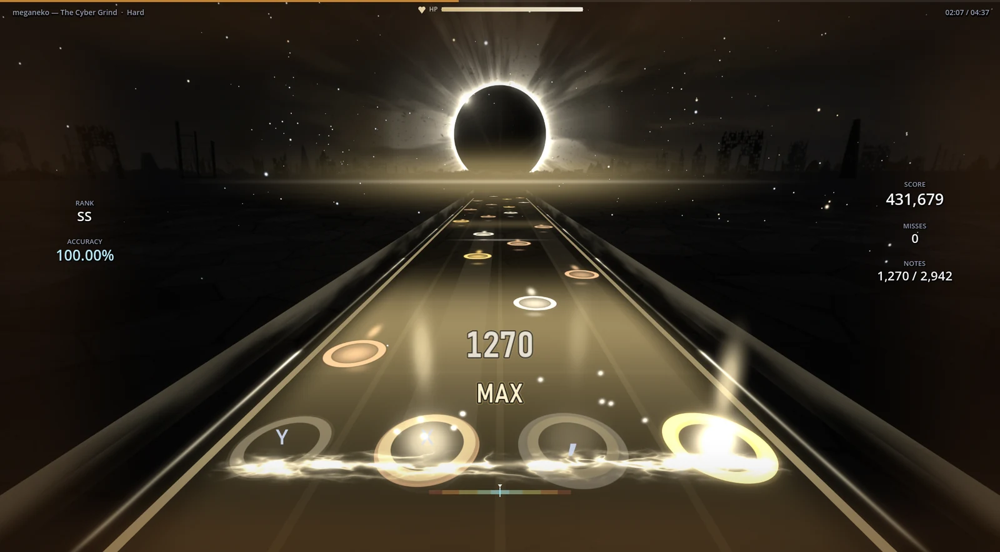

<h1 align="center">TETHRA</h1>

  <b>Free osu!mania 4K rhythm game for Windows. Play your own .osz beatmaps in 3D or classic 2D.</b>

  

  One file, everything included (game, all worlds, sample maps). No Godot needed. Updates install themselves.

  
  
  
  

  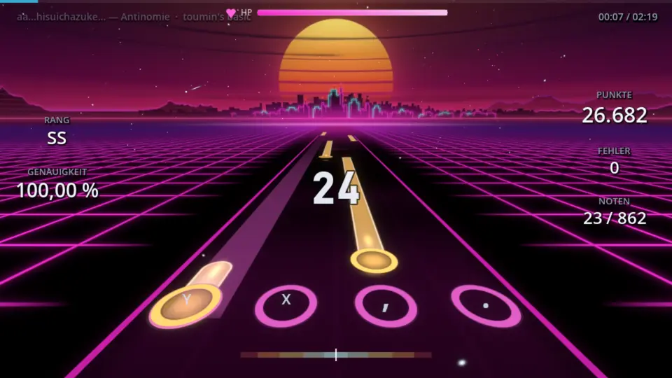

## Why TETHRA

- **Your maps, exact scoring.** osu!mania 4K `.osz` files with osu! judgement windows, ScoreV1 and SV maps that behave like in lazer.
- **3D or 2D.** A 3D lane with 13 worlds that react to the music, or a classic vertical playfield with osu! skins.
- **Turn any map into an SV map.** The SV mod adds beat-synced scroll changes to every map: notes bounce on the beat, surge, freeze, briefly run backwards and teleport, and still land exactly on time.
- **Orbit mode (preview).** Aim with mouse or tablet, tap with two keys: targets come in on two rings around the center, holds become arcs you follow. Every 4K map is playable in Orbit automatically.
- **Play together.** Rooms, teams, battle royale and tournaments with picks and bans.
- **Download in-game.** Search and fetch maps from the built-in online browser.

## Song browser and online download

<table>
  <tr>
    <td width="50%"><a href="docs/media/ui_browser.webp">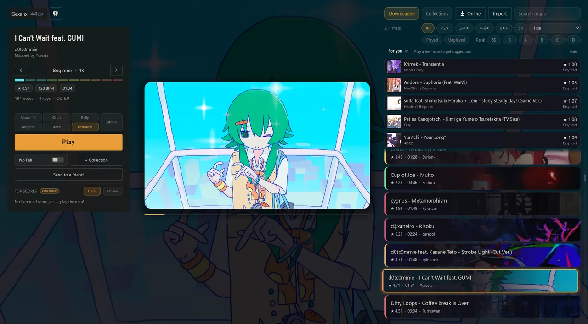</a> Song browser with previews, star rating and pp for your local maps.</td>
    <td width="50%"><a href="docs/media/ui_online.webp">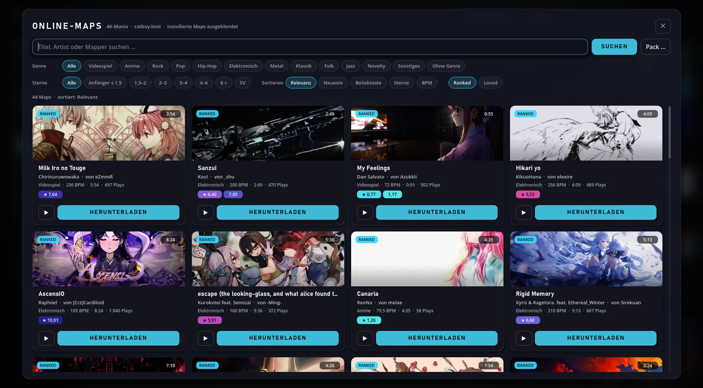</a> Online browser: search a map, download it, play it.</td>
  </tr>
  <tr>
    <td width="50%"><a href="docs/media/ui_menu.webp">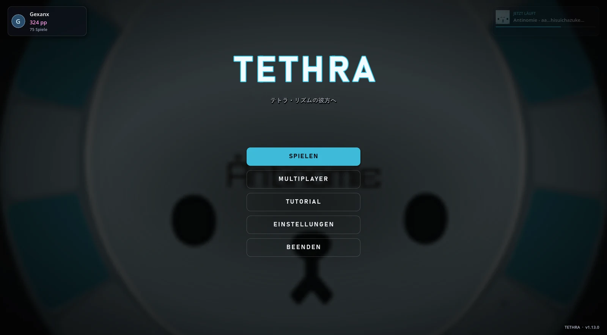</a> Main menu.</td>
    <td width="50%"> Live preview while you browse.</td>
  </tr>
</table>

## 3D worlds

  <a href="docs/media/play_3d_worlds.webp">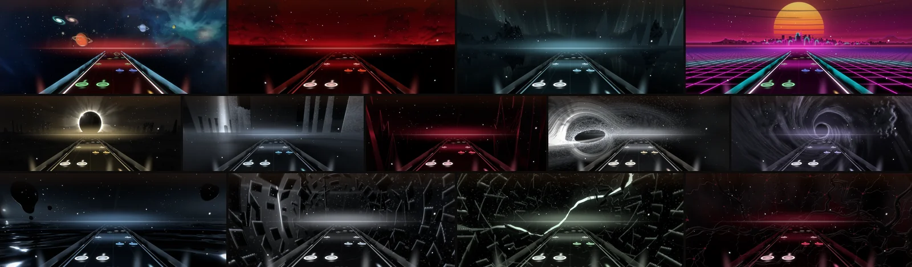</a> 
  Galaxy, Boss, Aurora, Neon, Eclipse, Abyss, Fractal, Obsidian, Storm, Singularity, Monolith, Rift and Nerve. Backgrounds pulse with the beat.

## Orbit mode

  <a href="docs/media/play_orbit.webp">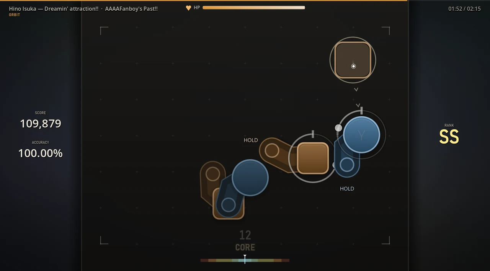</a> 
  Orbit: the cursor direction picks the angle, the left key hits the inner ring, the right key the outer ring. Arcs are holds. Switch between Mania 4K and Orbit in the song browser.

## SV mod

Switch on **SV** in the song browser and any map becomes an SV map. The mod writes its scroll changes from the map's own beat grid: a bounce on every beat in the chorus, calmer waves in the verses, short reverses, jumps and teleports on strong beats. Every note still arrives exactly on time, and maps that already have strong SV keep their own. Choose between Normal and Strong.

## 2D mode and skins

<table>
  <tr>
    <td width="50%"><a href="docs/media/play_2d.webp">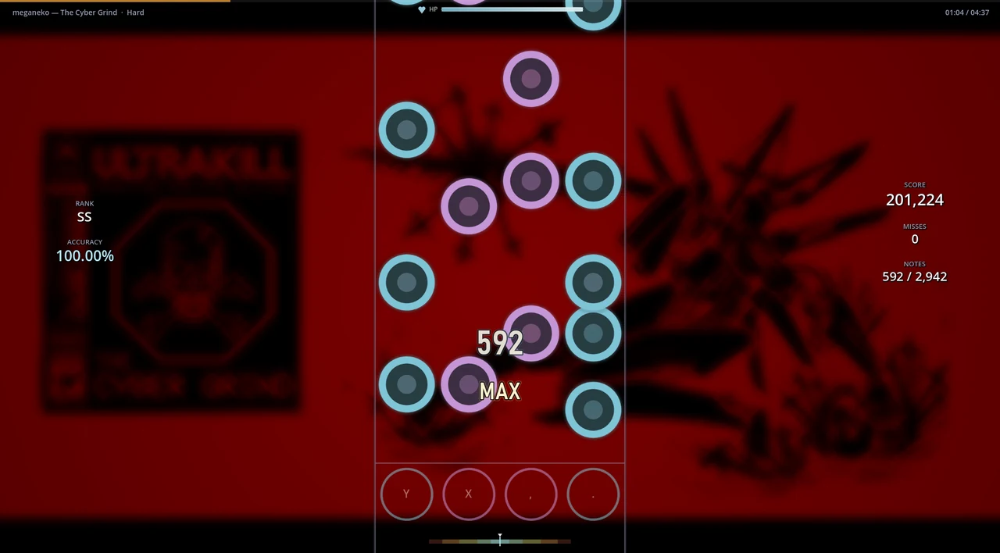</a> 2D mode: a classic vertical mania playfield.</td>
    <td width="50%"><a href="docs/media/play_2d_skins.webp">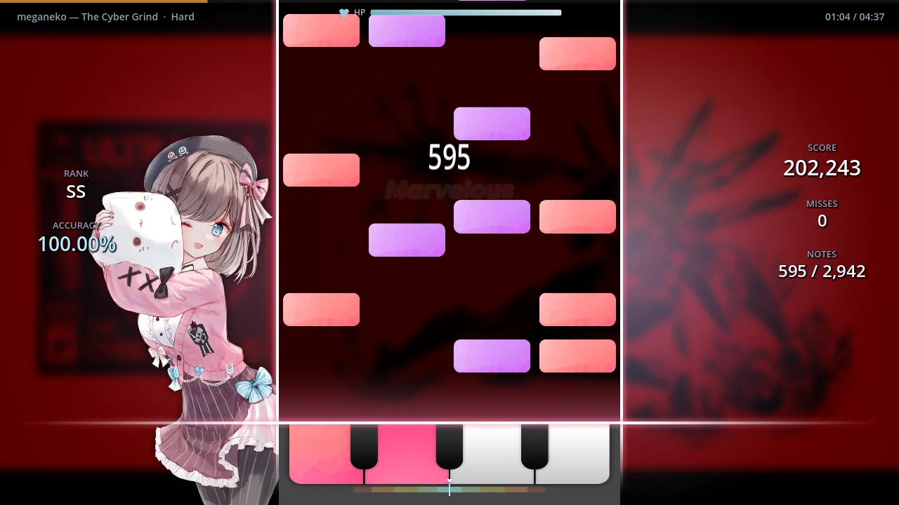</a> Import your osu! skins, or pick one of 3 built-in skins.</td>
  </tr>
  <tr>
    <td width="50%"><a href="docs/media/ui_settings_2d.webp">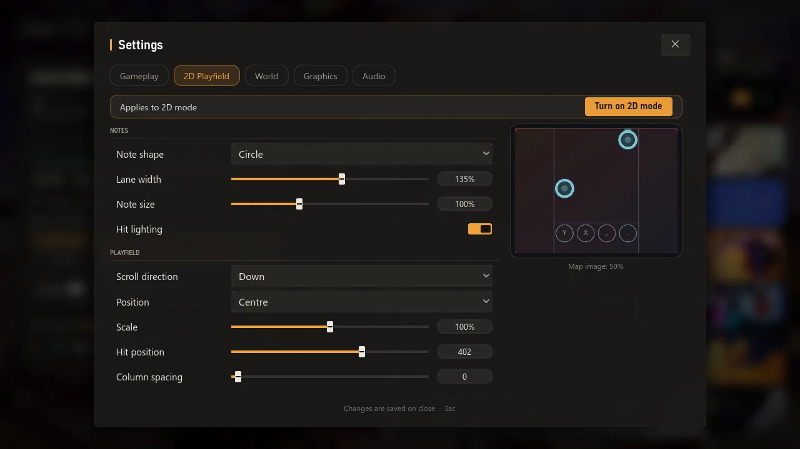</a> 2D size, skin and layout in Settings.</td>
    <td width="50%"><a href="docs/media/ui_settings.webp">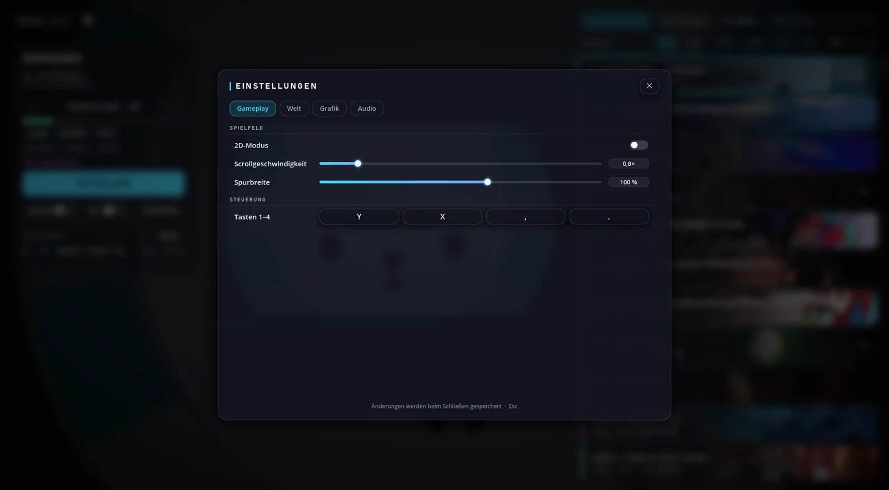</a> Settings: keys, scroll speed, offset, graphics, audio.</td>
  </tr>
</table>

## Multiplayer

<table>
  <tr>
    <td width="50%"><a href="docs/media/ui_lobby.webp">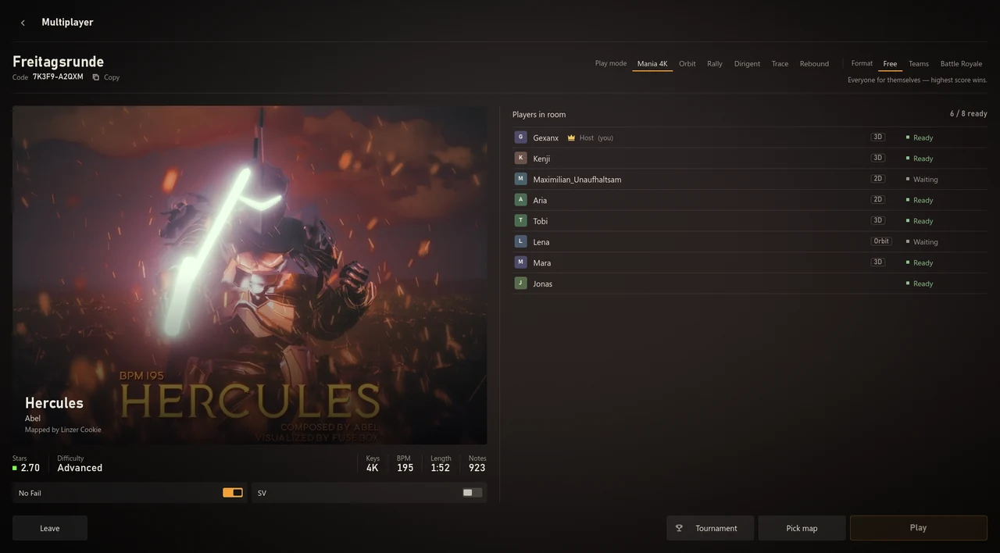</a> Rooms by code, teams and battle royale.</td>
    <td width="50%"><a href="docs/media/ui_tournament_pick.webp">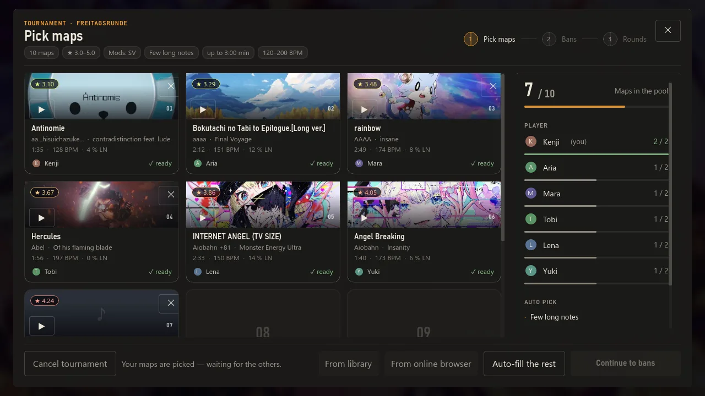</a> Tournament: picks and bans.</td>
  </tr>
  <tr>
    <td colspan="2" align="center"><a href="docs/media/ui_tournament_end.webp">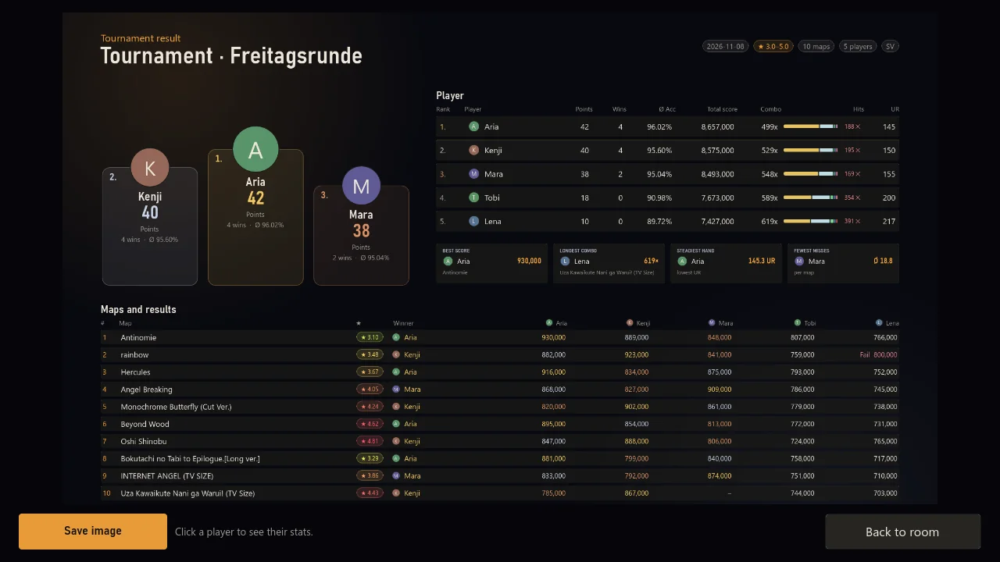</a> Tournament end screen.</td>
  </tr>
</table>

## Results and profile

<table>
  <tr>
    <td width="50%"><a href="docs/media/ui_results.webp">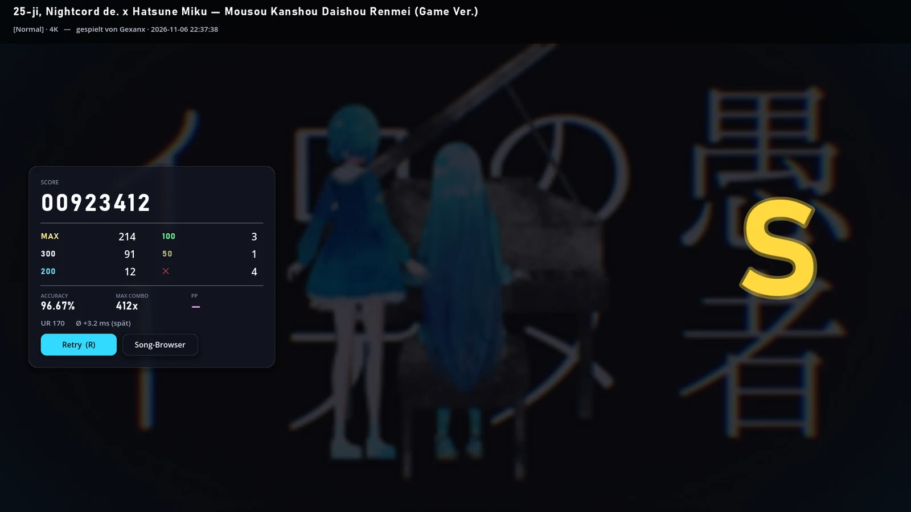</a> Results with judgements, accuracy and pp. Every play can be watched as a replay.</td>
    <td width="50%"><a href="docs/media/ui_profile.webp">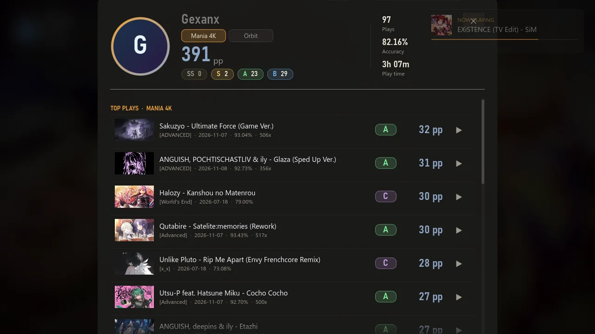</a> Profile with total pp and your best plays.</td>
  </tr>
</table>

## Features

| | |
| --- | --- |
| Maps | osu!mania 4K `.osz`, import from disk or the online browser |
| Scoring | osu! judgement windows, ScoreV1, hit error bar |
| SV maps | Scroll-speed changes as in osu!lazer |
| Difficulty | Star rating and pp via [rosu-pp](https://github.com/MaxOhn/rosu-pp) |
| Modes | 3D flight with 13 worlds, 2D playfield with osu! skins |
| Replays | Watch your plays again |
| Multiplayer | Rooms, teams, battle royale, tournaments |
| Updates | Auto-updater |

### Controls

| Action | Default key |
| --- | --- |
| Lanes 1-4 | `D` `F` `J` `K` |
| Hook | `Z` / `X` or left / right mouse button |
| Fullscreen | `F11` |

All keys can be rebound in Settings.

## Install

1. Download **[TETHRA_Setup.exe](https://github.com/Vyrenbusiness-source/TETHRA/releases/download/worlds/TETHRA_Setup.exe)** (about 430 MB). That is the only file you need.
2. Run it and click through. Windows may show "Windows protected your PC": click **More info**, then **Run anyway** (the game is not code-signed).
3. Start TETHRA from the desktop or start menu. New versions download and install themselves inside the game.

Graphics problems? Start "TETHRA (Kompatibilitätsmodus)" from the start menu (OpenGL instead of Vulkan).

The small `TETHRA.pck` files on the [release pages](https://github.com/Vyrenbusiness-source/TETHRA/releases) are only the update packages the game fetches by itself. You do not need to download them.

## Your maps

Put osu!mania 4K `.osz` files into the `maps/` folder, or use the online browser in the song select to download them. Other key counts are not supported.

## FAQ

**Does it need osu!?** No. TETHRA reads `.osz` files and runs on its own.

**Only 4K?** Yes, osu!mania 4K.

**Mac or Linux?** Windows only for now. You can build from source with Godot.

## Build from source

1. Install [Godot 4.7](https://godotengine.org/download).
2. Clone this repository and open `project.godot`, or run it directly: `godot --path .`
3. Export a pack: `godot --headless --path . --export-pack "Windows" TETHRA.pck`

## Credits

- osu! is a trademark of ppy Pty Ltd. TETHRA is an independent project and is not affiliated with osu!.
- Maps belong to their mappers. The online browser downloads through a public mirror.
- Star rating and pp: [rosu-pp](https://github.com/MaxOhn/rosu-pp).
- Built with [Godot Engine](https://godotengine.org).

## Deutsch

TETHRA ist ein 3D-Raumflug-Rhythmusspiel für osu!mania-4K-Beatmaps (`.osz`) mit exakter osu!-Wertung, 2D-Modus mit osu!-Skins, SV-Mod (jede Map wird zur SV-Map: Noten tanzen auf dem Beat), Orbit-Modus (zielen mit Maus/Tablet auf zwei Ringe, tippen mit zwei Tasten), Online-Map-Browser, Replays, Multiplayer und Turnieren. Installation: **[TETHRA_Setup.exe](https://github.com/Vyrenbusiness-source/TETHRA/releases/download/worlds/TETHRA_Setup.exe)** herunterladen (eine Datei, alles drin, kein Godot nötig), ausführen, spielen. Meldet Windows "Der Computer wurde durch Windows geschützt": **Weitere Informationen** → **Trotzdem ausführen**. Updates kommen automatisch im Spiel. Maps gehören ihren Mappern, osu! ist eine Marke von ppy.
