

  <picture>
    <source media="(prefers-color-scheme: dark)" srcset="docs/media/logo_wordmark.png">
    
  </picture>

  <b>A free rhythm game for Windows. Play osu!mania 4K maps in 3D or 2D, turn any map into an SV map, or play Orbit, Rally, Dirigent, Trace and Rebound, five rhythm modes of their own.</b>

  

  One installer, everything included: game, 13 worlds, sample maps. No osu! or Godot needed. Updates install themselves.

  
  
  

  <a href="docs/media/trailer.mp4">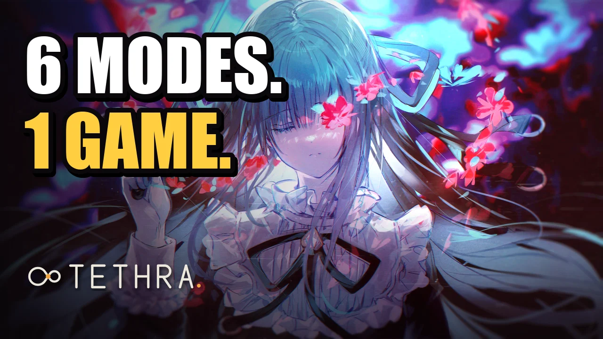</a> 
  <a href="docs/media/trailer.mp4"><b>▶ Watch the trailer</b></a> (79 s, all six modes)

  

## Six modes

<table>
  <tr>
    <td width="33%" align="center"><a href="docs/media/mania.mp4">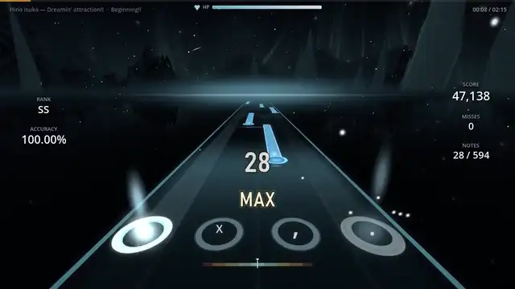</a> <b>Mania</b> osu!mania 4K in 3D worlds or the classic 2D field. <a href="docs/media/mania.mp4">▶ Watch with sound</a></td>
    <td width="33%" align="center"><a href="docs/media/orbit.mp4">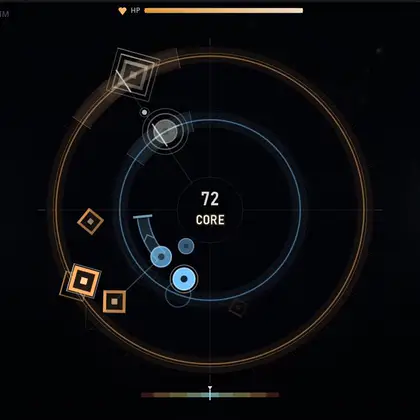</a> <b>Orbit</b> Aim at targets, count the satellite laps, hit on the beat. <a href="docs/media/orbit.mp4">▶ Watch with sound</a></td>
    <td width="33%" align="center"><a href="docs/media/rally.mp4">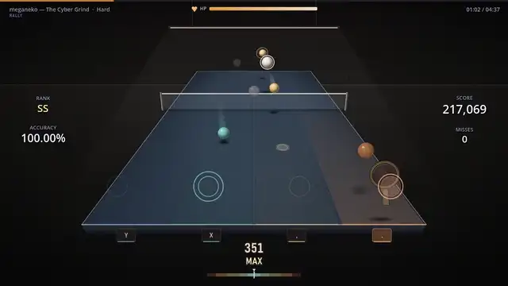</a> <b>Rally</b> Table tennis in the rhythm of the map. <a href="docs/media/rally.mp4">▶ Watch with sound</a></td>
  </tr>
  <tr>
    <td width="33%" align="center"><a href="docs/media/dirigent.mp4">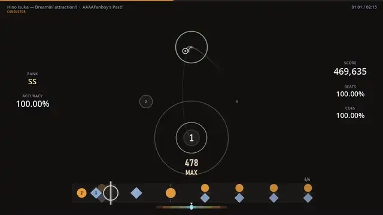</a> <b>Dirigent</b> Conduct the beat with the cursor, play the cues with two keys. <a href="docs/media/dirigent.mp4">▶ Watch with sound</a></td>
    <td width="33%" align="center"><a href="docs/media/trace.mp4">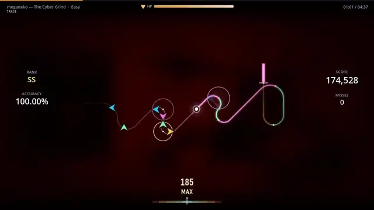</a> <b>Trace</b> A glowing thread draws the map as you play it. <a href="docs/media/trace.mp4">▶ Watch with sound</a></td>
    <td width="33%" align="center"><a href="docs/media/rebound.mp4">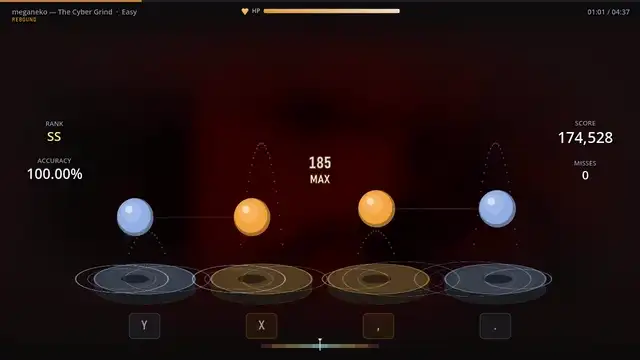</a> <b>Rebound</b> Four balls bounce on four drums and land on your notes. <a href="docs/media/rebound.mp4">▶ Watch with sound</a></td>
  </tr>
</table>

Every mode plays regular osu! maps (Trace and Rebound: osu!mania 4K maps) and has its own star rating, scores, leaderboards, replays and multiplayer.

## Orbit: aim at the target, count the laps

Targets appear on a beat at a place in the field. A satellite circles each target, exactly one lap per beat. Small pips under the target count the laps left, one disappears per beat. When the satellite crosses the mark at 12 o'clock in the last lap, it is time: put the cursor on the target and press the right key.

- **Beat.** Count it: "three, two, one, now". The target shows up on a beat, so the rhythm is visible before it is audible.
- **Keys.** Key A (mouse left or `Z`) hits cool discs. Key B (mouse right or `X`) hits warm rounded squares. A disc with a white ring is an accent: press both keys together.
- **Aim.** A press only counts when the cursor is on the target. The wrong key or a miss of the target gives no hit.
- **Holds.** Hit the head, keep the key down and follow the ball along the band to the end.
- **Maps.** Orbit plays regular osu! maps (osu!standard and 4K). Timing is the map's own, to the millisecond, and the converter keeps every target reachable.

Mods: Hidden, Fade-In and Precision (tighter windows). Your best Orbit runs add up to an Orbit rating in your profile. Settings: laps ahead, target size and cursor size.

   
  <a href="docs/media/orbit.mp4"><b>▶ Watch with sound</b></a> · New to Orbit? The game offers a short tutorial the first time you switch to it.

  <a href="docs/media/ui_orbit_results.webp">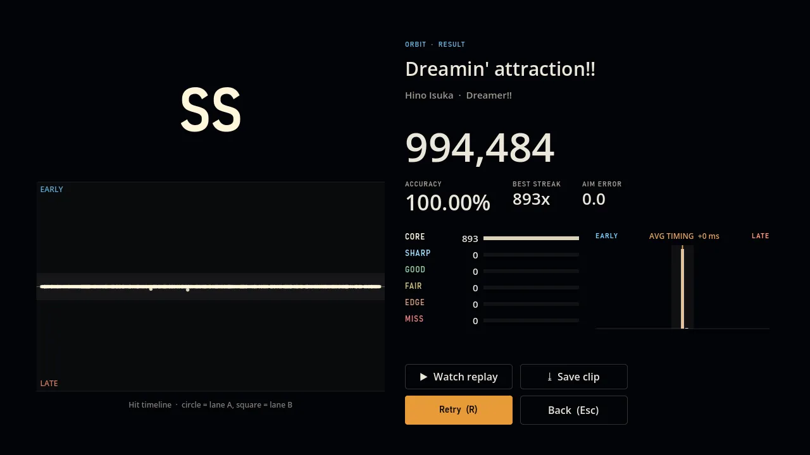</a> 
  Result: every hit on the timeline with timing. Grades CORE to MISS.

## Rally: table tennis to the beat

You look over the shoulder of your player: the camera sits behind and above your racket, the table runs away from you and the opponent stands at the far end. Every note of the map is one ball. It flies to the opponent, bounces and comes back, and reaches your racket at exactly the note time.

- **Zones.** Your half of the table has 4 zones, one per column (the Mania 4K keys, default `D` `F` `J` `K`). Maps with 3 zones use `F` `J` `K`. A ball lands in the zone of its note and you hit it with the key of that zone. The wrong zone gives no hit.
- **Smash.** A finish or a chord is a smash, ringed in white: press the zone keys together.
- **Charge.** A long note is a charge: hold the key and release at the end.
- **Timing.** A ring in the landing zone shrinks to the note time. The shadow of the ball shows the zone while it is still in the air.
- **Miss.** The ball flies past and the opponent serves again for the next note.

   
  <a href="docs/media/rally.mp4"><b>▶ Watch with sound</b></a>

## Dirigent: conduct the beat, play the cues

You do two things at once. With the mouse or pen you lead a conducting pattern: on every beat the cursor must be at the current point (4/4 goes down, left, right, up). With two keys you play the cues of the map: cues run along a strip under the pattern towards a hit line. Circles are key A, diamonds are key B, both together for a finish.

- **Pattern.** It follows the time signature of the map. Fast songs get a slower, longer pattern. Kiai sections swing wider.
- **Score.** 40 % beat (aim at each point), 60 % cues. One combo counts both.
- **Read.** The big point is the current beat with a ring that shrinks to the beat. The next point is small and numbered.

   
  <a href="docs/media/dirigent.mp4"><b>▶ Watch with sound</b></a>

## Trace: draw the beat

A glowing thread grows across the field at a steady speed. Every note is a bend of the thread, placed where the thread is at the note time. The arrow at the bend shows the direction: column 1 goes left, 2 down, 3 up, 4 right. The same column twice is a knot on a straight line, the opposite direction is a tight hairpin, a chord of two notes is a diagonal, 3 or 4 notes are a star. A hold is a thick glowing part of the thread until the release mark.

- **Read.** The path of the next 1.2 s is drawn ahead. A ring at each bend shrinks to the note time.
- **Keys.** Mania 4K keys, default `D` `F` `J` `K`. Judgement, holds, mods and star rating are the same as in Mania.
- **End.** After the last note the camera zooms out and shows the whole picture of the map.

   
  <a href="docs/media/trace.mp4"><b>▶ Watch with sound</b></a>

## Rebound: bounce on the beat

Four drums in a row, one ball over each. A ball lands on its drum exactly at the note time and bounces on to the next note of its column. Long pauses give a high arc, a jack is a quick dribble. A hold squashes the ball on the drum until the end of the note.

- **Read.** A ring on the drum shrinks to the note time. A faint ghost arc shows the next bounce. Chords land together and are joined by a thin line.
- **Keys.** The key under each drum, default `D` `F` `J` `K`. Judgement, holds, mods and star rating are the same as in Mania. Only osu!mania 4K maps.

   
  <a href="docs/media/rebound.mp4"><b>▶ Watch with sound</b></a>

## Suggestions for you

The song browser has a **For you** block above the list, in every mode. It picks maps by your own level, which it learns from your runs in that mode. Three levels:

- **Easy** is a little below your level, for a relaxed run.
- **Challenge** is at your level and a bit above. This is the default.
- **Push** is a step up, with maps that could enter your top 10.

Each card says why it was picked, for example the star range or a style you play well. Players with few runs get careful suggestions. Hide the block with **Hide**.

  

## Tutorials for every mode

Every mode has a short interactive tutorial. The game offers it the first time you switch to a mode. You can start it later from the **?** next to the mode in the main menu or from **Tutorial** in the song browser.

  

## Any map becomes an SV map

Switch on **SV** in the song browser. The mod writes scroll changes from the map's own beat grid: notes bounce on every beat in the chorus, surge, hold, run backwards for a moment and jump on strong beats. They still arrive exactly on time. Two levels: Normal and Strong.

  <a href="docs/media/sv_mod.mp4">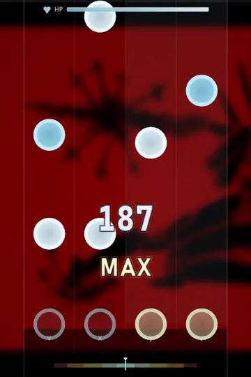</a> 
  meganeko – The Cyber Grind, a map without its own SV. <a href="docs/media/sv_mod.mp4"><b>▶ Watch with sound</b></a>

## 3D worlds and the classic 2D field

   
  13 worlds that move with the music: Galaxy, Boss, Aurora, Neon, Eclipse, Abyss, Fractal, Obsidian, Storm, Singularity, Monolith, Rift, Nerve.

<table>
  <tr>
    <td width="50%"> 2D with the options you know from osu!mania: scroll speed 1–40, direction, hit position, column spacing, Hidden / Fade-In / Cover.</td>
    <td width="50%"> Import your osu! skins (.osk), or use one of 3 built-in skins in your own note colours.</td>
  </tr>
</table>

## Maps, scores and friends

<table>
  <tr>
    <td width="50%"> Song browser per mode (Mania, Orbit, Rally, Dirigent, Trace, Rebound), each with its own star rating; pp for Mania, collections, star ranges, SV, played / unplayed and rank filters, and sorting.</td>
    <td width="50%"> Search and download ranked maps in the game, for Mania and for Orbit.</td>
  </tr>
  <tr>
    <td width="50%"> Results with judgements, UR, early/late, hit error and accuracy over time. Replays and video clips.</td>
    <td width="50%"><a href="docs/media/ui_orbit_fail.webp">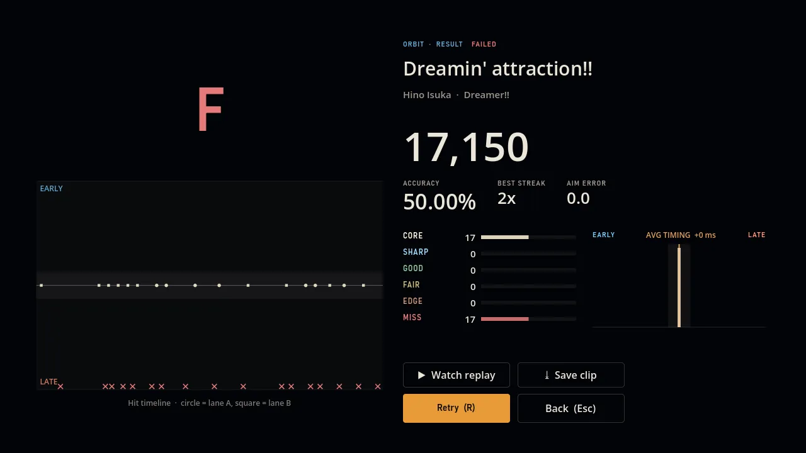</a> A failed run still shows every hit and miss on the timeline. In Mania the fail screen also names the likely cause (a lag spike, early releases, a burst of misses).</td>
  </tr>
  <tr>
    <td width="50%"> Multiplayer by room code: free, teams, battle royale, in all four modes.</td>
    <td width="50%"> Tournaments with picks, bans and auto-pick filters.</td>
  </tr>
  <tr>
    <td width="50%"> Tournament standings with every player's stats.</td>
    <td width="50%"><a href="docs/media/ui_chat.webp">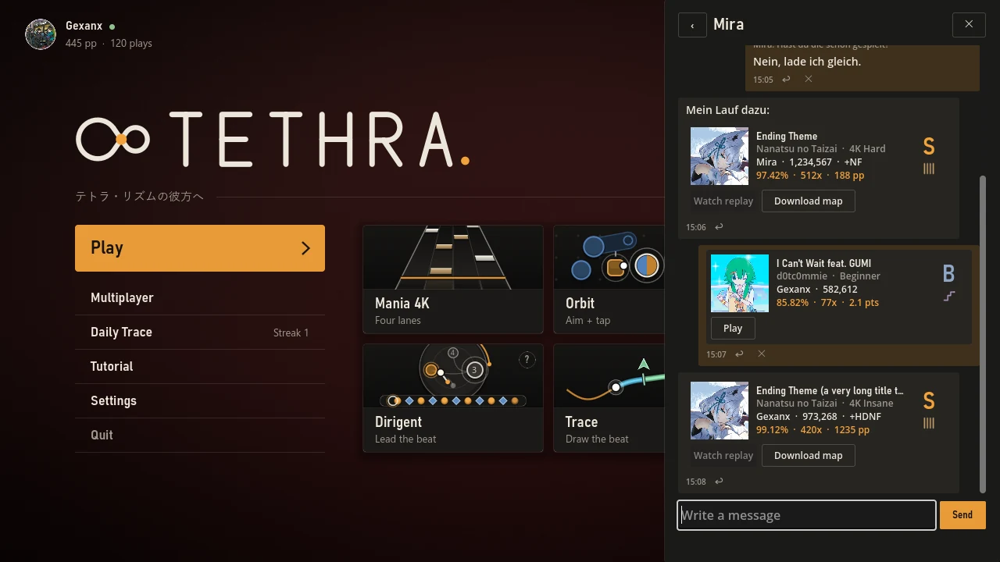</a> Chat: press <code>F</code> anywhere. Maps and scores arrive as cards you can preview, download or replay.</td>
  </tr>
</table>

## Online account

Sign in or register in the game (or on [butzebot.com](https://butzebot.com/tethra)). The account is optional; without it everything works offline.

<table>
  <tr>
    <td width="50%"><a href="docs/media/ui_login.webp">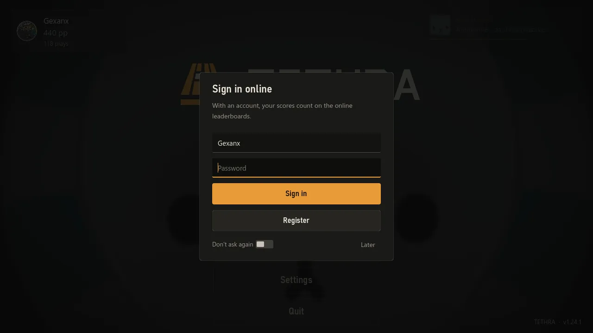</a></td>
    <td valign="top">
      <ul>
        <li><b>Leaderboards</b> per map and mode (Mania, Orbit). Your best runs count.</li>
        <li><b>Web profiles</b> on butzebot.com with your scores, rating and profile picture.</li>
        <li><b>Chat</b> with other players (<code>F</code>). Share a map or one of your scores.</li>
        <li><b>Replays</b> upload with your score. Others can watch them from the leaderboard or from a chat card.</li>
        <li><b>Multiplayer</b> runs through the server, so you need no port forwarding. LAN stays an option.</li>
      </ul>
    </td>
  </tr>
</table>

## Your own music

Drop an `.mp3`, `.ogg` or `.wav` onto the song browser, or pick it with **Import**. TETHRA finds the tempo and beats and builds an Orbit map in about a second. It is playable in Orbit only. It needs FFmpeg next to the game or on your PATH. Import also takes `.osz` files and a whole osu! `Songs` folder (4K Mania and osu!standard maps).

## Install

1. Download **[TETHRA_Setup.exe](https://github.com/Vyrenbusiness-source/TETHRA/releases/download/worlds/TETHRA_Setup.exe)** (about 430 MB).
2. Run it. If Windows shows "Windows protected your PC", click **More info**, then **Run anyway**. The game is not code-signed.
3. Start TETHRA from the desktop or the start menu. New versions install themselves.

Graphics problems? Start "TETHRA (Kompatibilitätsmodus)" from the start menu (OpenGL instead of Vulkan). After a crash the game starts in a safe graphics mode by itself.

The `TETHRA.pck` files on the [release pages](https://github.com/Vyrenbusiness-source/TETHRA/releases) are the update packages the game downloads on its own. You do not need them.

## FAQ

**Do I need osu!?** No. TETHRA plays `.osz` files on its own and downloads maps in the game.

**Which maps?** osu!mania 4K for Mania (3D and 2D), Trace and Rebound, osu!standard and 4K for Orbit, Rally and Dirigent.

**Keys?** Mania lanes default to `D` `F` `J` `K`, Orbit and Dirigent use the left/right mouse button or `Z` / `X` for key A / B. Rally (4 zones), Trace and Rebound use the Mania keys, Rally with 3 zones uses `F` `J` `K`. `F` opens the chat. Everything can be rebound in Settings.

**Mac or Linux?** Windows only for now. You can build from source with Godot 4.7.

## Build from source

1. Install [Godot 4.7](https://godotengine.org/download).
2. Clone this repository and open `project.godot`, or run `godot --path .`
3. Export a pack: `godot --headless --path . --export-pack "Windows" TETHRA.pck`

## Credits

- osu! is a trademark of ppy Pty Ltd. TETHRA is an independent project and is not affiliated with osu!.
- Maps belong to their mappers. The online browser downloads through a public mirror.
- Star rating and pp: [rosu-pp](https://github.com/MaxOhn/rosu-pp). Clips are encoded with [FFmpeg](https://ffmpeg.org) (GPL, shipped as a separate program).
- Built with [Godot Engine](https://godotengine.org).

## Deutsch

TETHRA ist ein kostenloses Rhythmusspiel für Windows: osu!mania-4K-Maps in 3D oder 2D, jede Map per SV-Mod als SV-Map (Noten tanzen auf dem Beat) und fünf eigene Modi mit normalen osu!-Maps: Orbit (Ziele erscheinen auf dem Beat, ein Satellit kreist eine Runde pro Beat, Punkte zählen die Runden herunter; im letzten Umlauf zielst du auf das Ziel und drückst Taste A, B oder beide beim Akzent), Rally (Tischtennis im Takt der Map), Dirigent (Taktfigur mit der Maus führen, Einsätze mit zwei Tasten spielen), Trace (ein Leuchtfaden zeichnet die Map, jede Note ist ein Knick in Richtung ihrer Spalte) und Rebound (vier Bälle hüpfen auf vier Trommelfellen und landen genau auf den Noten; beide nur mit 4K-Maps). Rally läuft mit Blick hinter den Spieler und 4 Zonen (oder 3). Der Browser schlägt unter „For you“ passende Maps vor (Easy, Challenge, Push) und lernt dein Level und deinen Stil, und jeder Modus hat ein kurzes Tutorial. Zu jedem Modus gibt es oben ein Video mit Ton. Dazu Online-Konto mit Bestenlisten, Web-Profilen und Chat, Replays, Multiplayer über den Server, eigene Musik als Orbit-Map, Online-Map-Browser, osu!-Skins, Clips und Turniere. Installation: **[TETHRA_Setup.exe](https://github.com/Vyrenbusiness-source/TETHRA/releases/download/worlds/TETHRA_Setup.exe)** herunterladen, ausführen, spielen. Meldet Windows „Der Computer wurde durch Windows geschützt“: **Weitere Informationen** → **Trotzdem ausführen**. Updates kommen automatisch. Maps gehören ihren Mappern, osu! ist eine Marke von ppy.
