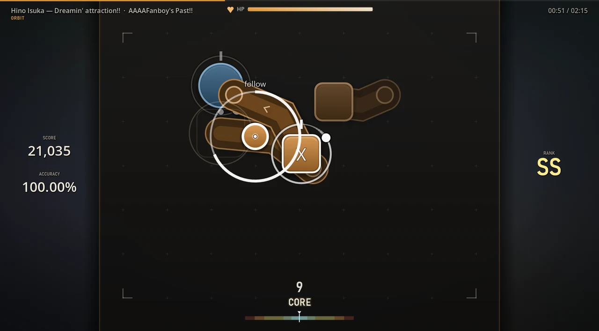
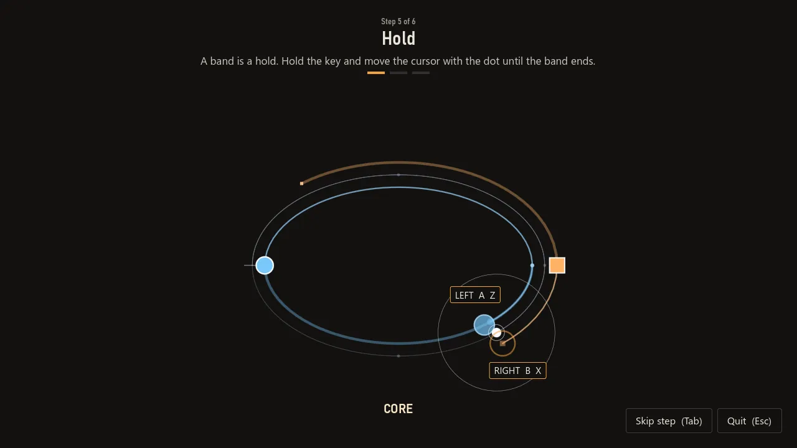

  <picture>
    <source media="(prefers-color-scheme: dark)" srcset="docs/media/logo_wordmark.png">
    
  </picture>

  <b>A free rhythm game for Windows. Play osu!mania 4K maps in 3D or 2D, turn any map into an SV map, or follow a runner along looping tracks in Orbit, a mode of its own.</b>

  

  One installer, everything included: game, 13 worlds, sample maps. No osu! or Godot needed. Updates install themselves.

  
  
  

  

## Orbit: follow the runner, tap the lanes

A white runner circles once per bar along a closed track. The track changes shape with the song: circle, ellipse, a figure eight, or a flower with three or four petals. A change shows up one bar ahead as a thin line, and only on the first beat of a bar. Notes sit on the track at their place in the bar, on lane A (left of the runner, discs) or lane B (right, squares).

- **Aim.** Put the mouse or pen on the runner and move along with it. A tap only counts when the cursor is close to the runner.
- **Lanes.** Left key (mouse left or `Z`) hits lane A, right key (mouse right or `X`) hits lane B. Both together hit an accent.
- **Holds.** A band is a hold: keep the key down and follow the runner until the band ends. A fuse burns down the track from the runner to the next note of the lane.
- **Read ahead.** One bar is visible. Notes of the next bar are dimmed and get brighter as the runner nears them. The track pulses with the music.
- **Maps.** Orbit plays regular osu! maps (osu!standard and 4K). Timing is the map's own, to the millisecond, and the converter keeps every note reachable.

Mods: Hidden, Fade-In and Precision (tighter windows). Your best Orbit runs add up to an Orbit rating in your profile.

   
  <a href="docs/media/orbit.mp4"><b>▶ Watch with sound</b></a> · New to Orbit? The game offers a one-minute tutorial the first time you switch to it.

<table>
  <tr>
    <td width="50%"> Figure eight. Lane A: discs. Lane B: squares. Bands are holds.</td>
    <td width="50%"> Flower track. The thin circle around the runner shows how close the cursor must be.</td>
  </tr>
  <tr>
    <td width="50%"> The tutorial teaches aiming, lanes, accents, holds and the preview in six steps.</td>
    <td width="50%"> Result: every hit on the timeline by lane and timing. Grades CORE to MISS.</td>
  </tr>
</table>

## Any map becomes an SV map

Switch on **SV** in the song browser. The mod writes scroll changes from the map's own beat grid: notes bounce on every beat in the chorus, surge, hold, run backwards for a moment and jump on strong beats. They still arrive exactly on time. Two levels: Normal and Strong.

   
  meganeko – The Cyber Grind, a map without its own SV. <a href="docs/media/sv_mod.mp4"><b>▶ Watch with sound</b></a>

## 3D worlds and the classic 2D field

   
  13 worlds that move with the music: Galaxy, Boss, Aurora, Neon, Eclipse, Abyss, Fractal, Obsidian, Storm, Singularity, Monolith, Rift, Nerve.

<table>
  <tr>
    <td width="50%"> 2D with the options you know from osu!mania: scroll speed 1–40, direction, hit position, column spacing, Hidden / Fade-In / Cover.</td>
    <td width="50%"> Import your osu! skins (.osk), or use one of 3 built-in skins in your own note colours.</td>
  </tr>
</table>

## Maps, scores and friends

<table>
  <tr>
    <td width="50%"> Song browser per mode with star rating (Orbit has its own), pp, collections, star ranges, SV, played / unplayed and rank filters, and sorting.</td>
    <td width="50%"> Search and download ranked maps in the game, for Mania and for Orbit.</td>
  </tr>
  <tr>
    <td width="50%"> Results with judgements, UR, early/late, hit error and accuracy over time. Replays and video clips.</td>
    <td width="50%"> A failed run still shows every hit and miss on the timeline. In Mania the fail screen also names the likely cause (a lag spike, early releases, a burst of misses).</td>
  </tr>
  <tr>
    <td width="50%"> Multiplayer by room code: free, teams, battle royale, Mania or Orbit.</td>
    <td width="50%"> Tournaments with picks, bans and auto-pick filters.</td>
  </tr>
  <tr>
    <td width="50%"> Tournament standings with every player's stats.</td>
    <td width="50%"> Chat: press <code>F</code> anywhere. Maps and scores arrive as cards you can preview, download or replay.</td>
  </tr>
</table>

## Online account

Sign in or register in the game (or on [butzebot.com](https://butzebot.com/tethra)). The account is optional; without it everything works offline.

<table>
  <tr>
    <td width="50%"></td>
    <td valign="top">
      <ul>
        <li><b>Leaderboards</b> per map and mode (Mania, Orbit). Your best runs count.</li>
        <li><b>Web profiles</b> on butzebot.com with your scores, rating and profile picture.</li>
        <li><b>Chat</b> with other players (<code>F</code>). Share a map or one of your scores.</li>
        <li><b>Replays</b> upload with your score. Others can watch them from the leaderboard or from a chat card.</li>
        <li><b>Multiplayer</b> runs through the server, so you need no port forwarding. LAN stays an option.</li>
      </ul>
    </td>
  </tr>
</table>

## Your own music

Drop an `.mp3`, `.ogg` or `.wav` onto the song browser, or pick it with **Import**. TETHRA finds the tempo and beats and builds an Orbit map in about a second. It is playable in Orbit only. It needs FFmpeg next to the game or on your PATH. Import also takes `.osz` files and a whole osu! `Songs` folder (4K Mania and osu!standard maps).

## Install

1. Download **[TETHRA_Setup.exe](https://github.com/Vyrenbusiness-source/TETHRA/releases/download/worlds/TETHRA_Setup.exe)** (about 430 MB).
2. Run it. If Windows shows "Windows protected your PC", click **More info**, then **Run anyway**. The game is not code-signed.
3. Start TETHRA from the desktop or the start menu. New versions install themselves.

Graphics problems? Start "TETHRA (Kompatibilitätsmodus)" from the start menu (OpenGL instead of Vulkan). After a crash the game starts in a safe graphics mode by itself.

The `TETHRA.pck` files on the [release pages](https://github.com/Vyrenbusiness-source/TETHRA/releases) are the update packages the game downloads on its own. You do not need them.

## FAQ

**Do I need osu!?** No. TETHRA plays `.osz` files on its own and downloads maps in the game.

**Which maps?** osu!mania 4K for Mania (3D and 2D), osu!standard and 4K for Orbit.

**Keys?** Mania lanes default to `D` `F` `J` `K`, Orbit uses the left/right mouse button or `Z` / `X` for lane A / B. `F` opens the chat. Everything can be rebound in Settings.

**Mac or Linux?** Windows only for now. You can build from source with Godot 4.7.

## Build from source

1. Install [Godot 4.7](https://godotengine.org/download).
2. Clone this repository and open `project.godot`, or run `godot --path .`
3. Export a pack: `godot --headless --path . --export-pack "Windows" TETHRA.pck`

## Credits

- osu! is a trademark of ppy Pty Ltd. TETHRA is an independent project and is not affiliated with osu!.
- Maps belong to their mappers. The online browser downloads through a public mirror.
- Star rating and pp: [rosu-pp](https://github.com/MaxOhn/rosu-pp). Clips are encoded with [FFmpeg](https://ffmpeg.org) (GPL, shipped as a separate program).
- Built with [Godot Engine](https://godotengine.org).

## Deutsch

TETHRA ist ein kostenloses Rhythmusspiel für Windows: osu!mania-4K-Maps in 3D oder 2D, jede Map per SV-Mod als SV-Map (Noten tanzen auf dem Beat) und Orbit, ein eigener Modus: Ein Läufer kreist pro Takt über Bahnen (Kreis, Acht, Blüte), du folgst ihm mit Maus oder Tablet und triffst mit zwei Tasten – mit normalen osu!-Maps. Dazu Online-Konto mit Bestenlisten, Web-Profilen und Chat, Replays, Multiplayer über den Server, eigene Musik als Orbit-Map, Online-Map-Browser, osu!-Skins, Clips und Turniere. Installation: **[TETHRA_Setup.exe](https://github.com/Vyrenbusiness-source/TETHRA/releases/download/worlds/TETHRA_Setup.exe)** herunterladen, ausführen, spielen. Meldet Windows „Der Computer wurde durch Windows geschützt“: **Weitere Informationen** → **Trotzdem ausführen**. Updates kommen automatisch. Maps gehören ihren Mappern, osu! ist eine Marke von ppy.
