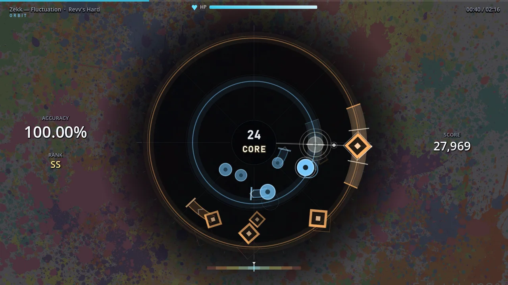
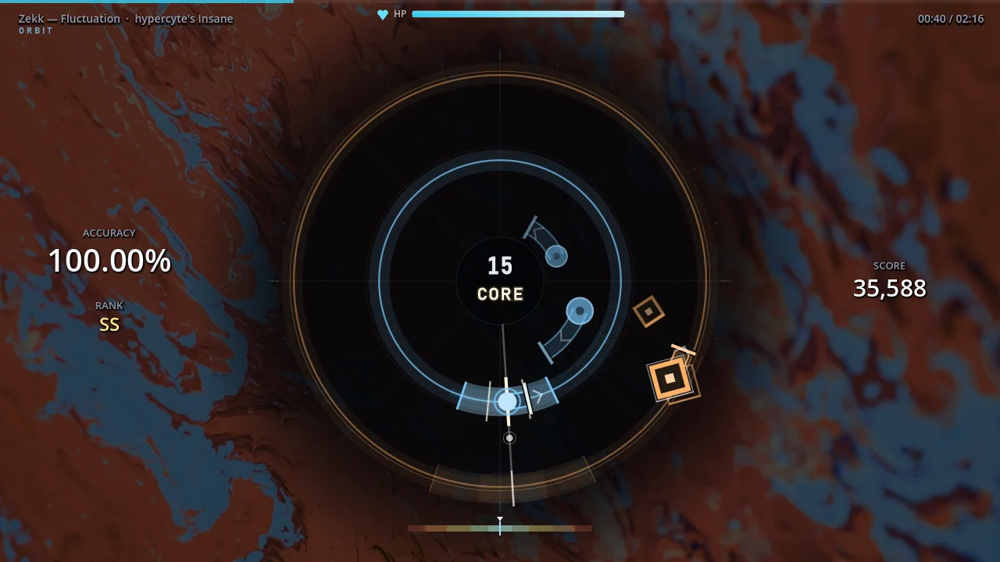
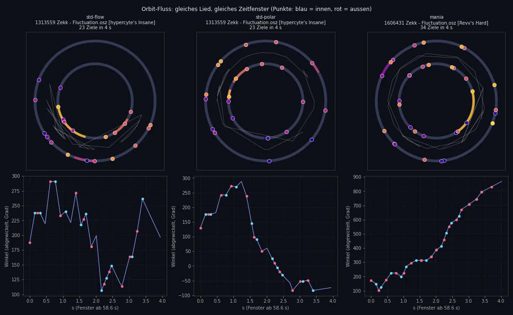
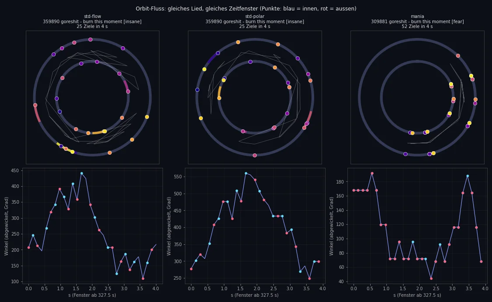

# Orbit: osu!standard vs. osu!mania 4K as map source

Question: do normal osu! maps (osu!standard, mode 0) work better for Orbit than converted osu!mania 4K maps?

**Answer: yes. osu!standard is Orbit's main source; 4K mania stays as a fallback.**

## How each source is converted

| | osu!standard (mode 0) | osu!mania 4K (mode 3) |
|---|---|---|
| Angle | Direction of the object from the playfield centre (256, 192), mode `POLAR` | Column + pattern flow |
| Ring | Distance from the centre | Pattern logic |
| Holds | Sliders become arcs that follow the slider path | Long notes become arcs |
| Objects | Kept 1:1 | Dense passages reduced |
| Timing | Original times, exact | Original times, exact |

Both use the same fairness limits (see `docs/modes/orbit.md`): at most 0.6°/ms of cursor speed, at most 90° when the gap is under 150 ms, at least 90 ms between two taps on the same ring (150 ms after an arc), chords only at the same angle.

## Measurements (4 osu!standard sets, 11 diffs, against 4K maps of the same songs)

| Metric | osu!standard | 4K mania |
|---|---|---|
| Targets on audible beats (Insane level) | 60–84 % | 52–71 % |
| Strongest accents covered | 31–81 % (weakest on Normal/Hard) | 73–98 % |
| Targets per second | 1x | 1.5–2x |
| Fairness rule violations | 0 | 0 |
| Perfect bot | SS, no misses | SS, no misses |
| Median angle off the original osu! position (`POLAR`) | 0° (p90 0–64°) | – |

The alternative mapping `FLOW` (osu! movement distance turned into ring distance) was tested and dropped: its median angle error was about 90°, so it lost the map's layout.

## What it looks like

Same song (Zekk – Fluctuation), same moment. Left: converted 4K map, targets pile up in one sector. Right: osu!standard, targets spread around the circle and the slider is a real arc.

  
  

Angle over time (flow): mania charts stay in a small region or turn steadily; osu!standard sweeps the whole circle.

  
  

## Consequences in the game

- The song browser shows osu!standard maps only in Orbit mode; Mania mode keeps showing 4K maps only.
- The online browser has a "Mania 4K | Orbit" switch; Orbit searches ranked/loved osu!standard maps.
- 4K maps remain playable in Orbit as a fallback.
- Debug: `--maps-dir=<dir>` plays a test folder without touching the user library.
